<p align="center">
  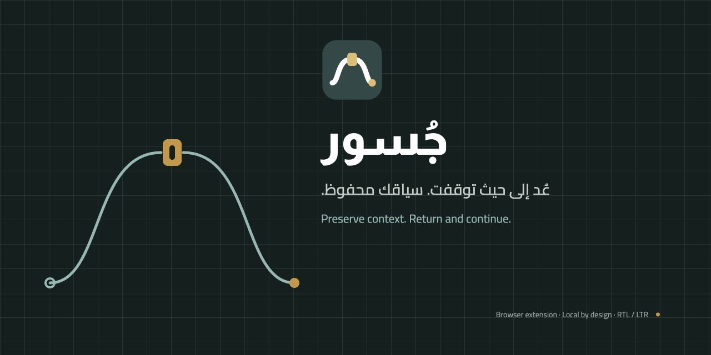
</p>

<h1 align="center">جُسور — Jusoor</h1>

<p align="center">
  <strong>A browser extension that saves your working context, not just your tabs.</strong><br>
  The pages you chose, why you opened each one, where you stopped, and what comes next —<br>
  restored the moment you come back.
</p>

<p align="center">
  <a href="#installation"><strong>Install</strong></a> ·
  <a href="#features">Features</a> ·
  <a href="#screenshots">Screenshots</a> ·
  <a href="#privacy">Privacy</a> ·
  <a href="#faq">FAQ</a> ·
  <a href="README.md">العربية</a>
</p>

<p align="center">
  <a href="https://github.com/iSltanX/Jusoor/releases/latest"></a>
  <a href="LICENSE"></a>
</p>

<p align="center">
  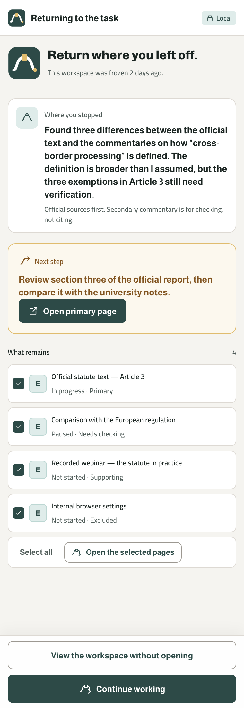
  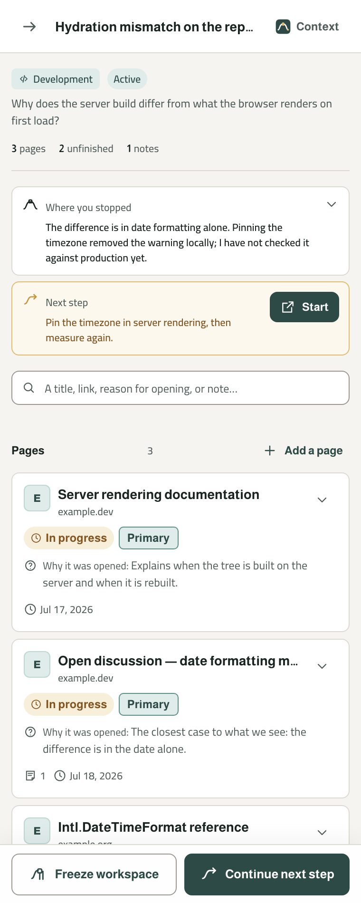
  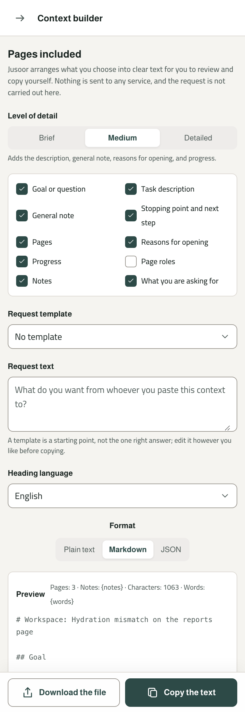
</p>

<p align="center"><em>The return screen · inside a workspace · the context builder — real captures of the built extension.</em></p>

---

## Why Jusoor?

You open eleven pages to answer one question. You read six of them, dismiss two, flag one as suspect, and try a fix that half works. Then the day ends. Three days later you open those pages again — and none of them remember any of that. The links came back. The thinking didn't.

What got lost was never in the tabs: why each page was opened, what you had read and what was still waiting, which sources you trusted and which you ruled out, what you tried and how it went, and the one thing you meant to do next.

| Tool | What it is designed to remember | What it does not carry |
|---|---|---|
| **Bookmarks** | An address, worth keeping indefinitely | Why you saved it, or which task it belonged to |
| **Browser history** | That you visited something, chronologically | Which visits were one piece of work, and which were noise |
| **Tab groups** | What is open right now, in this window | Anything after you close the window |
| **Reading list** | That an article is unread | Progress, judgement, notes, or what to do next |
| **Session managers** | The set of tabs, so it can reopen them | The reasoning that made the set meaningful |

Each stores **the address**; what you lose is **the context around it**. In Jusoor, a workspace holds one task: its pages, why each one is there, your notes, **where you stopped**, and **the next step**. When you come back, Jusoor shows you where you were **before it opens anything**, and you choose what to reopen.

> Jusoor doesn't return you to the pages. It returns you to the point where you stopped — in your work and in your thinking.

**Why "Jusoor"?** **جُسور** (*jusūr*) is Arabic for **bridges**. A bridge doesn't shorten the distance; it makes crossing it possible without losing what you carry — a crossing between the session that ended and the session that begins. The mark is a **saved path**: a quiet beginning, a small gate where context is stored, and an amber end that stands for the return and the next step.

---

## Typical workflow

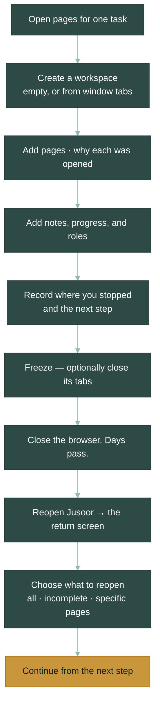

Nothing in that chain is mandatory except creating a workspace; every field is optional.

---

## Features

- **🗂 Workspaces** — One workspace per task or question: its pages, notes, stopping point, and next step, in an active, frozen, or archived state. Create one empty, or from your window's tabs — you pick which, and duplicate links are flagged, never silently merged.
- **📄 Page context** — Every page carries a **reason for opening**, a **progress status** (not started · in progress · paused · complete), a **role** (primary · supporting · needs checking · excluded), optional labels, and notes. Progress and role are deliberately separate dimensions.
- **📍 Stopping point & next step** — The two most prominent fields in the product: **where you stopped**, and **the next step** you'll start with.
- **🧊 Freeze & return** — Freezing saves the workspace, its pages, their order, and notes; you can also close that workspace's tabs, always behind an explicit confirmation and never automatically. Coming back opens the return screen in a fixed order: where you stopped → next step → what remains → restore summary.
- **🔓 Honest restore** — Reopen everything, only the incomplete pages, or a specific selection, with a warning before opening many tabs at once. Each page reports what actually happened — opened, or could not be opened (such as `chrome://` pages the browser won't open from an extension) — and its saved data stays intact.
- **🔍 Search & organization** — Search in Arabic and English across workspaces (name, goal, description, general note, stopping point, next step) and pages (title, link, reason, labels, notes). Arabic search ignores diacritics and the أ/إ/آ and ي/ى variants. Pages sort (original order, most recently added, primary first) and filter by progress, role, or having notes.
- **📋 Context builder** — Assembles what **you** select into clear text: three levels of detail, five templates (research, reviewing a development problem, summarize, compare, continue the work), an editable preview before copying, and a privacy notice before every copy. Shortening includes fewer *kinds of data*; it never rewrites your words. It sends nothing anywhere — you paste the text where you choose.
- **📦 Export & import** — **JSON** with a declared schema for backup and transfer (one workspace or all), and an import with strict validation that writes nothing until it passes. On conflict, four explicit choices: create a copy, replace, merge the non-duplicate pages, or cancel. **Plain text** and **Markdown** are for reading and sharing, not backups.
- **🗑 Deletion** — Permanently delete a page or a whole workspace after an explicit confirmation. There is no trash; a JSON backup is the way back.
- **🌐 Arabic & English, light & dark** — One RTL/LTR interface built on logical CSS properties, with light and dark themes. Language follows the browser by default, and changing it never translates your content.

### What Jusoor is not

- **Not a tab manager.** It doesn't try to own, suspend, or slim down your tabs.
- **Not an AI extension.** No model, no API key, no summarizing, no judging your sources.
- **Not a cloud or sync service.** No server, no account, no sign-in, no cross-device sync.
- **Not a notes app or a reference manager.** Notes attach to a page or a workspace, and Jusoor records *your* judgement about a source without formatting citations.

---

## Privacy

**Local first is enforced by the browser itself.**

- **No accounts, no cloud, no tracking or analytics** — there is no server to receive your data, and no usage data of any kind.
- **Your page content is never read** — no content scripts, no `scripting` permission, no site permissions.
- **Your data stays on your device** — workspaces and pages in a local IndexedDB, settings in `chrome.storage.local`.

The extension ships with this content security policy:

```
script-src 'self'; object-src 'self'; connect-src 'none'
```

`connect-src 'none'` blocks `fetch`, `XMLHttpRequest`, `WebSocket`, `EventSource`, and `sendBeacon` at runtime for everything running in the extension's pages — our code and any dependency alike. So the guarantee is **the browser refusing to let a connection happen**, not merely that we wrote no network calls. Automated guards back it up by scanning the source, the built output, and the shipped manifest for both Chrome and Edge.

**The trade-off:** because storage is entirely local, **clearing your browser data or removing the extension deletes your workspaces**, and no one else holds a copy. Export a JSON backup once your work matters.

Full policy, Arabic and English: [docs/privacy-policy.md](docs/privacy-policy.md)

### Permissions

Jusoor installs with **no permission warning**. The only permission that would raise one is optional, and declining it doesn't break the product.

| Permission | Kind | Why it exists | If you decline |
|---|---|---|---|
| `storage` | Required | Saving your language and theme preferences on your device | — |
| `sidePanel` | Required | The side panel *is* the interface | — |
| `activeTab` | Required | Reading the **title and URL** of the current tab after you click "Read the open page". Page content is never read | — |
| `tabs` | **Optional** | Requested only on an explicit click: listing window tabs so you can pick among them, and identifying a workspace's tabs to close them on freeze | Manual workspace creation, freezing without closing, and adding pages by URL all keep working |

**Deliberately not requested:** `scripting` · `host_permissions` · `<all_urls>` · `unlimitedStorage` · `downloads` · `history` · `bookmarks` · `cookies` · `webNavigation` · `identity` · `tabGroups` · `declarativeNetRequest`. An automated guard asserts the exact permission set in the built manifest. Reasoning: [ADR 0004](docs/decisions/0004-permissions.md) · [ADR 0012](docs/decisions/0012-current-page-capture.md).

---

## Screenshots

Captures of the built extension at the reference panel width (380px), not mockups. Arabic versions are in the [Arabic README](README.md#لقطات-الشاشة).

<table>
<tr>
<td width="33%">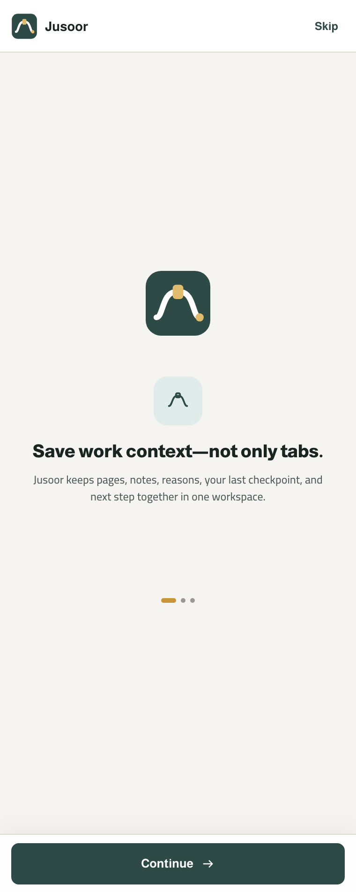</td>
<td width="33%">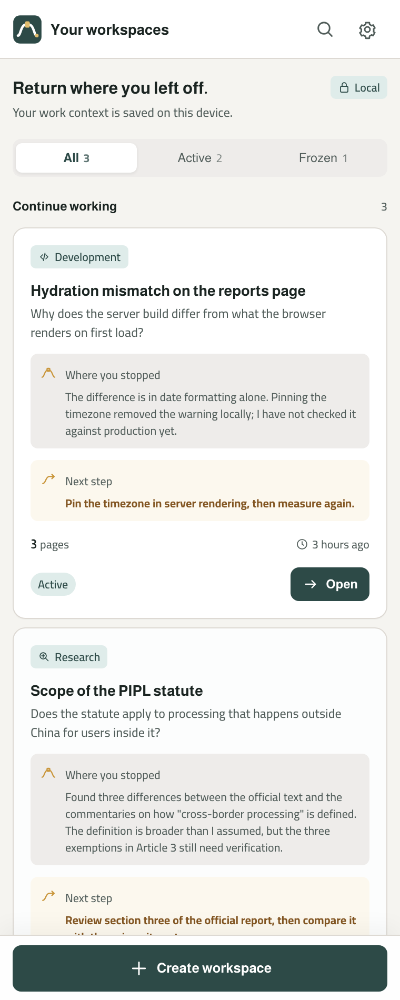</td>
<td width="33%"></td>
</tr>
<tr>
<td valign="top"><strong>First run</strong><br>What is stored and where, before you build on it.</td>
<td valign="top"><strong>Your workspaces</strong><br>The next step first, sorted by most recently worked, not created.</td>
<td valign="top"><strong>Inside a workspace</strong><br>Stopping point and next step above the pages.</td>
</tr>
<tr>
<td>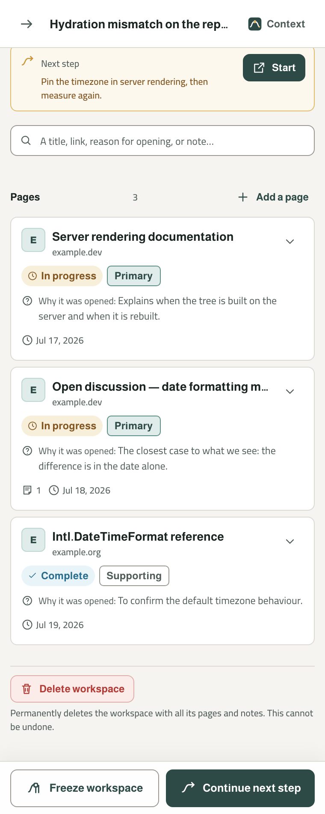</td>
<td>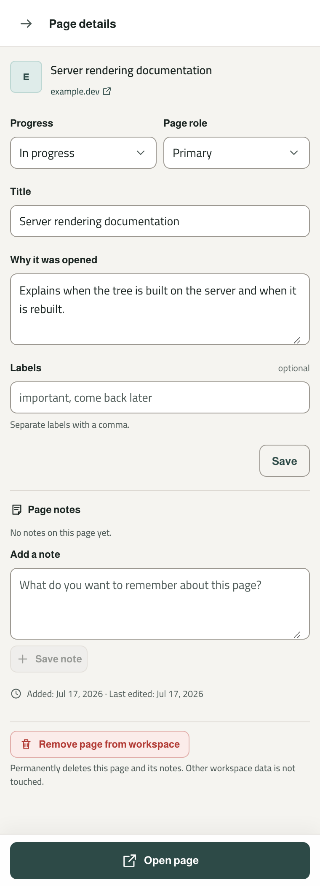</td>
<td>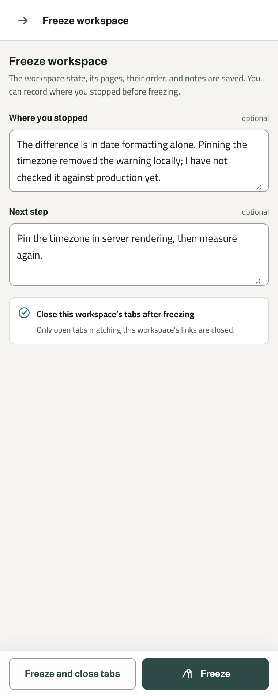</td>
</tr>
<tr>
<td valign="top"><strong>Pages, search and filter</strong><br>Progress, role, and note count for each page.</td>
<td valign="top"><strong>Page details</strong><br>Reason, progress, role, labels, and notes.</td>
<td valign="top"><strong>Freeze</strong><br>Recording where you stopped is optional; closing tabs is a separate choice.</td>
</tr>
<tr>
<td></td>
<td></td>
<td>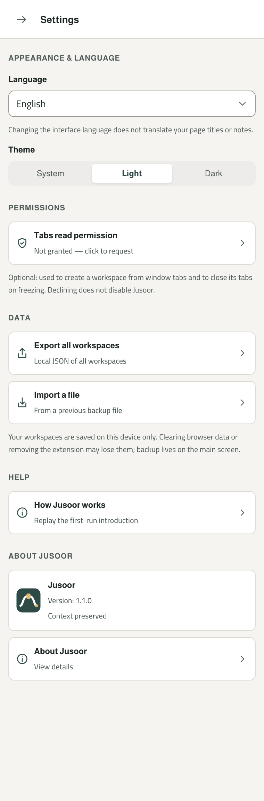</td>
</tr>
<tr>
<td valign="top"><strong>The return screen</strong><br>Where you stopped, the next step, and what remains — before a single tab opens.</td>
<td valign="top"><strong>The context builder</strong><br>Detail level, template, what to include, and a preview before copying.</td>
<td valign="top"><strong>Settings</strong><br>Language and theme, the tabs permission, export and import, and About.</td>
</tr>
</table>

<table>
<tr>
<td width="25%"></td>
<td width="25%">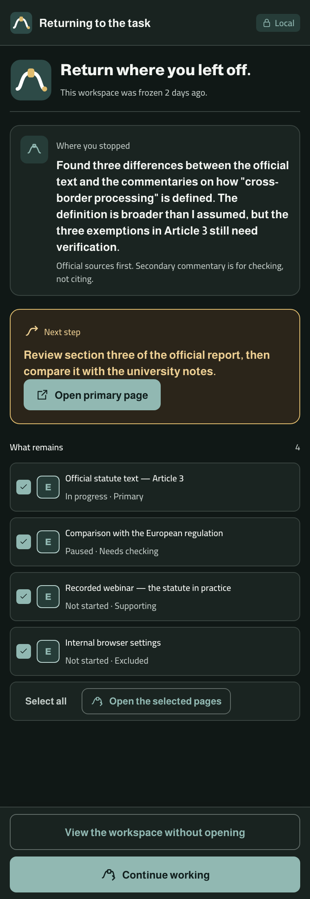</td>
<td width="25%">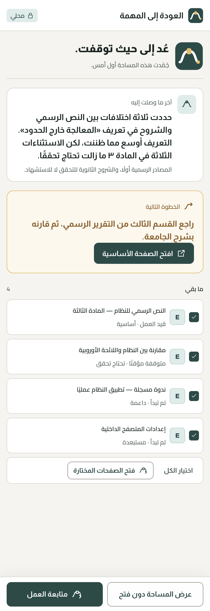</td>
<td width="25%">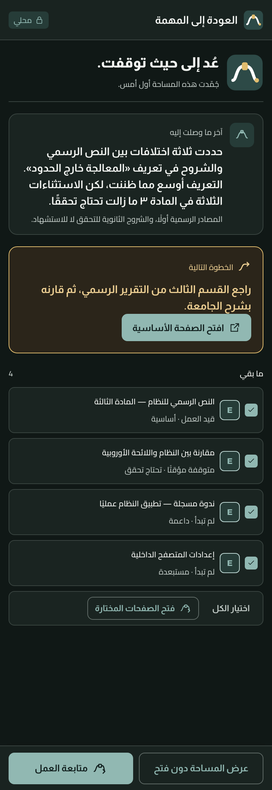</td>
</tr>
<tr>
<td align="center"><sub>English · light</sub></td>
<td align="center"><sub>English · dark</sub></td>
<td align="center"><sub>Arabic · light</sub></td>
<td align="center"><sub>Arabic · dark</sub></td>
</tr>
</table>

---

## Installation

**Browsers:** Google Chrome and Microsoft Edge (Manifest V3 with the `chrome.sidePanel` side panel) — Jusoor is built and verified on both. Other Chromium browsers with side panel support (Brave, Opera, Vivaldi) should work but are **not tested**. Firefox is not supported for now ([ADR 0002](docs/decisions/0002-target-browsers.md)).

Jusoor is not yet published to the Chrome Web Store or Microsoft Edge Add-ons; install it from the GitHub release package:

1. Download `jusoor-…-chrome.zip` (or `jusoor-…-edge.zip` for Edge) from the [latest release](https://github.com/iSltanX/Jusoor/releases/latest).
2. Unzip it into a permanent folder; an unpacked extension runs from that folder.
3. Open `chrome://extensions` (or `edge://extensions`) and turn on **Developer mode**.
4. Click **Load unpacked** and select the folder that contains `manifest.json`.
5. Pin Jusoor to the toolbar and click its icon — the side panel opens.

> **Note:** a manually loaded extension does not update itself. To update, export a JSON backup, replace the contents of the same folder with the new release, and click **Reload** on the extensions page — the browser ties an unpacked extension's data to its folder path. Chrome may also show a developer-mode notice on start; it doesn't affect your data.

---

## Development

Requirements: **Node.js 22.13** or newer (required by pnpm 11) and **pnpm 11**.

```bash
git clone https://github.com/iSltanX/Jusoor.git
cd Jusoor
pnpm install
pnpm build            # → .output/chrome-mv3
pnpm build:edge       # → .output/edge-mv3
```

```bash
pnpm dev              # development run (Chrome)
pnpm dev:edge         # development run (Edge)
pnpm zip              # .output/jusoor-<version>-chrome.zip
pnpm zip:edge         # .output/jusoor-<version>-edge.zip
pnpm typecheck        # tsc --noEmit
pnpm lint             # eslint
pnpm test             # vitest
pnpm check            # typecheck → lint → test → build
pnpm verify:identity  # verify the identity package integrity alone
```

> **A note on `pnpm dev`:** the `connect-src 'none'` policy blocks the HMR connection, so you have to reload the extension manually after each change. This is intentional.

### Structure

```
entrypoints → ui → app → core
                    ├→ storage
                    └→ browser
```

```
src/
├── core/         product logic — pure TypeScript, no side effects, no UI strings
├── browser/      the only place chrome.* appears
├── storage/      IndexedDB and chrome.storage.local
├── app/          use-case coordination
├── ui/           React components and screens
├── i18n/         interface text (ar / en)
└── entrypoints/  background · sidepanel

tests/            tests for each layer, plus guards/ for architecture and boundary guards
docs/decisions/   architecture decision records (19)
identity/         the approved identity package — read-only
licenses/fonts/   font licences (OFL 1.1)
```

**The direction is enforced by tests, not by convention.** The guards in `tests/guards/` fail on: `chrome.*` outside `src/browser/`, a dependency going the wrong way between layers, any network API or external resource in the source or the built output, any change to the permission set, any tampering with the identity package, raw colours or physical direction properties in component CSS, and shipping the fonts without their licences. The output guards only run when `.output/` exists, so run `pnpm test` after `pnpm build` to cover the build too.

### Before changing anything

- [`Jusoor-Product-Constitution.md`](Jusoor-Product-Constitution.md) — what the product is, what it refuses to become, and the acceptance criteria for any addition (Arabic).
- [`Jusoor-Identity-Constitution.md`](Jusoor-Identity-Constitution.md) — the visual system, tokens, components, accessibility, and constants (Arabic).
- The relevant ADR in [`docs/decisions/`](docs/decisions/).

`identity/` is a **byte-identical** copy of an approved subset of the identity package, enforced by a guard against the checksums in [`docs/identity-checksums.txt`](docs/identity-checksums.txt) (details in [`docs/identity-source.md`](docs/identity-source.md)). It is never edited and nothing we produce is added to it; derived values live in `src/ui/theme/`.

### Reporting issues

To report a bug or suggest an improvement, open an [issue](https://github.com/iSltanX/Jusoor/issues) — the same destination as the "Report an issue" link on the About screen.

---

## FAQ

<details>
<summary><strong>Is Jusoor available in the Chrome Web Store or Edge Add-ons?</strong></summary><br>

Not yet. Version 1.1.0 is published on [GitHub Releases](https://github.com/iSltanX/Jusoor/releases/latest) with Chrome and Edge packages, and has not been submitted to either store. See [Installation](#installation).
</details>

<details>
<summary><strong>Where is my data, exactly?</strong></summary><br>

On your device, in your browser profile. Workspaces, pages, notes, and classifications live in a local **IndexedDB** database named `jusoor`. Language, theme, the first-run flag, and a pointer to the last-used workspace live in `chrome.storage.local`. Nowhere else.
</details>

<details>
<summary><strong>What happens if I clear my browser data?</strong></summary><br>

You lose your workspaces — no server holds a copy, and Jusoor tells you so on first run. Export a JSON backup from Settings ("Export all workspaces"); it is a complete, re-importable copy.
</details>

<details>
<summary><strong>Can Jusoor read the pages I visit?</strong></summary><br>

No — by construction, not by promise. It ships no content scripts and requests neither `scripting` nor any host permission, so the browser gives it no way to read page content. It reads a tab's **title and URL** only, after you explicitly ask it to.
</details>

<details>
<summary><strong>Does it use AI?</strong></summary><br>

No. There is no model, no API key, and no outbound connection. The context builder assembles the text *you* selected so you can review and copy it yourself.
</details>

<details>
<summary><strong>Does it restore my scroll position inside a page?</strong></summary><br>

No — and it doesn't claim to. Reading-position capture needs a content script, which this version deliberately doesn't ship. Jusoor reopens the page and reports honestly what it did.
</details>

<details>
<summary><strong>Can I use it offline?</strong></summary><br>

Yes, entirely. Only opening the remote sources themselves needs a connection.
</details>

---

## License

Jusoor's code is licensed under [MIT](LICENSE) — © 2026 Sultan.

The **Almarai** and **Cairo** fonts are distributed under the SIL Open Font License 1.1; their licence texts live in [`licenses/fonts/`](licenses/fonts/) and ship inside the built package. Full third-party attribution: [THIRD_PARTY_NOTICES.md](THIRD_PARTY_NOTICES.md).

---

<p align="center">
  <sub>Designed and developed by <strong>سلطان · Sultan</strong> — Design &amp; Development</sub><br>
  <sub>Contact: <a href="mailto:S@BySltan.com">S@BySltan.com</a></sub><br>
  <sub><a href="CHANGELOG.md">Changelog</a> · <a href="docs/privacy-policy.md">Privacy policy</a> · <a href="docs/decisions/">Decisions</a> · <a href="README.md">العربية</a></sub>
</p>
