<p align="center">
  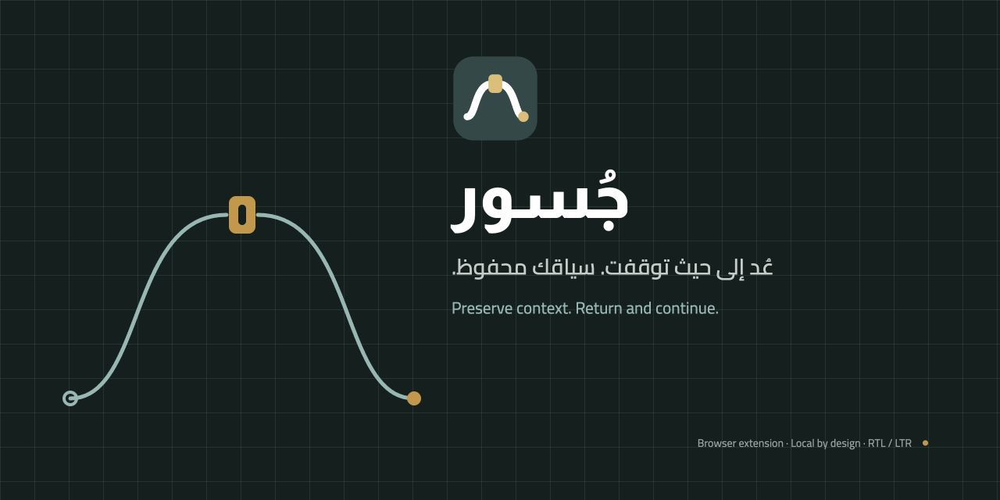
</p>

<h1 align="center">جُسور — Jusoor</h1>

<p align="center">
  <strong>إضافة متصفح تحفظ سياق عملك، لا تبويباتك وحدها.</strong><br>
  الصفحات التي اخترتها، وسبب فتح كل واحدة، وأين توقفت، وما الخطوة التالية —<br>
  تعود إليك كاملةً لحظة رجوعك.
</p>

<p align="center">
  <a href="#التثبيت"><strong>التثبيت</strong></a> ·
  <a href="#المزايا">المزايا</a> ·
  <a href="#لقطات-الشاشة">اللقطات</a> ·
  <a href="#الخصوصية">الخصوصية</a> ·
  <a href="#أسئلة-متكررة">الأسئلة</a> ·
  <a href="README.en.md">English</a>
</p>

<p align="center">
  <a href="https://github.com/iSltanX/Jusoor/releases/latest"></a>
  <a href="LICENSE"></a>
</p>

<p align="center">
  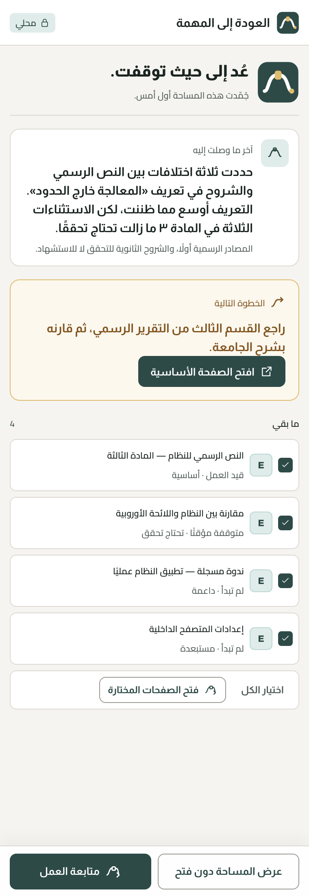
  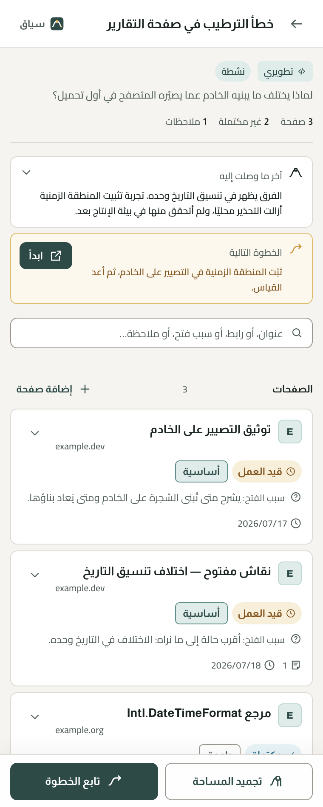
  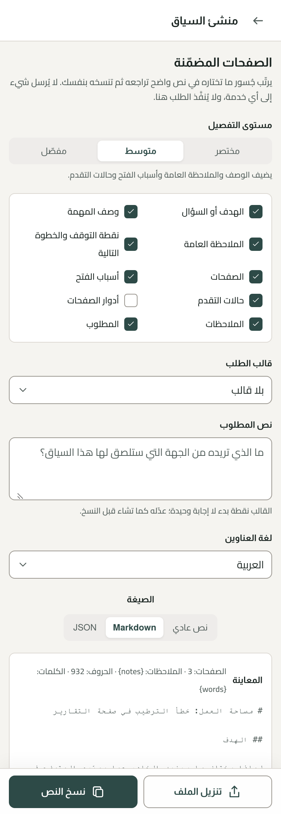
</p>

<p align="center"><em>شاشة العودة · داخل المساحة · منشئ السياق — لقطات حقيقية من الحزمة المبنية.</em></p>

---

## لماذا جُسور؟

تفتح إحدى عشرة صفحة للإجابة عن سؤال واحد. تقرأ ستًّا منها، وتستبعد اثنتين، وتشك في واحدة، وتجرّب حلًّا ينجح نصف نجاح. ثم ينتهي اليوم. وبعد ثلاثة أيام تفتح الصفحات نفسها فلا تتذكر أيٌّ منها شيئًا من ذلك: عادت الروابط، ولم يعد التفكير.

ما ضاع لم يكن في التبويبات أصلًا: سبب فتح كل صفحة، وما قرأته وما بقي، والمصادر التي وثقت بها والتي استبعدتها، وما جرّبته ونتيجته، والخطوة التي كنت تنوي فعلها بعد ذلك.

| الأداة | ما صُممت لتتذكره | ما لا تحمله |
|---|---|---|
| **المفضلة** | عنوانًا يستحق البقاء طويلًا | لماذا حفظته، ولأي مهمة كان |
| **سجل التصفح** | أنك زرت شيئًا، مرتبًا زمنيًا | أي الزيارات كانت عملًا واحدًا، وأيها ضجيج |
| **مجموعات التبويبات** | ما هو مفتوح الآن في هذه النافذة | أي شيء بعد إغلاق النافذة |
| **قائمة القراءة** | أن مقالًا لم يُقرأ بعد | التقدم، والحكم، والملاحظات، والخطوة التالية |
| **مديرو الجلسات** | مجموعة التبويبات ليعيدوا فتحها | الاستدلال الذي جعل لتلك المجموعة معنى |

كلها تحفظ **العنوان**، والذي تفقده هو **السياق حوله**. في جُسور تحمل مساحة العمل مهمة واحدة: صفحاتها، وسبب كل صفحة، وملاحظاتك، و**أين توقفت**، و**الخطوة التالية**. وعند العودة يعرض جُسور موضعك السابق **قبل أن يفتح أي شيء**، ثم تختار أنت ما يُفتح.

> جُسور لا يعيدك إلى الصفحات؛ بل يعيدك إلى النقطة التي توقفت عندها في عملك وتفكيرك.

**لماذا «جُسور»؟** الجسر لا يختصر المسافة؛ بل يجعل عبورها ممكنًا دون أن تفقد ما تحمله — عبور بين جلسة انتهت وجلسة تبدأ. والرمز **مسار محفوظ**: بداية هادئة، وبوابة صغيرة يُحفظ عندها السياق، ونهاية عنبرية تمثل العودة والخطوة التالية.

---

## رحلة استخدام نموذجية

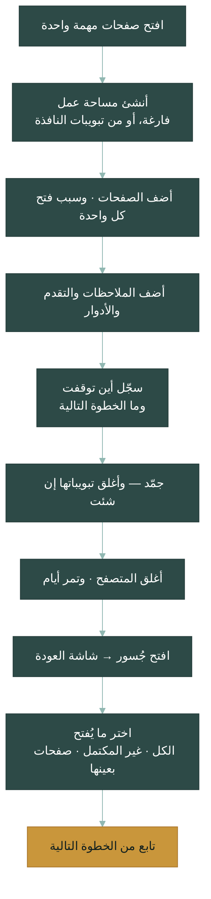

لا شيء في هذه السلسلة إلزامي عدا إنشاء المساحة؛ كل الحقول اختيارية.

---

## المزايا

- **🗂 مساحات العمل** — مساحة لكل مهمة أو سؤال: صفحاته وملاحظاته ونقطة توقفه وخطوته التالية، وحالتها نشطة أو مجمدة أو مؤرشفة. تنشئها فارغة، أو من تبويبات نافذتك تختار منها ما تشاء، ويُنبَّه على الروابط المكررة ولا تُدمج صامتًا.
- **📄 سياق الصفحة** — لكل صفحة **سبب الفتح**، و**التقدم** (لم تبدأ · قيد العمل · متوقفة مؤقتًا · مكتملة)، و**الدور** (أساسية · داعمة · تحتاج تحققًا · مستبعدة)، ووسوم اختيارية، وملاحظات. التقدم والدور بُعدان منفصلان عمدًا.
- **📍 نقطة التوقف والخطوة التالية** — حقلان هما أوضح عنصرين في المنتج: **آخر ما وصلت إليه**، و**الخطوة التالية** التي تبدأ بها.
- **🧊 التجميد والعودة** — التجميد يحفظ المساحة وصفحاتها وترتيبها وملاحظاتها، ويمكنك معه إغلاق تبويبات المساحة بتأكيد صريح، ولا يقع ذلك تلقائيًا أبدًا. والعودة تبدأ بشاشة ثابتة الترتيب: أين توقفت ← الخطوة التالية ← ما بقي ← ملخص الاستعادة.
- **🔓 استعادة صادقة** — تختار ما يُفتح: الكل، أو غير المكتمل، أو صفحات بعينها، ويسبق فتحَ عدد كبير منها تنبيه. وتُبلَّغ بنتيجة كل صفحة كما وقعت: فُتحت، أو تعذّر فتحها (مثل صفحات `chrome://` التي يرفض المتصفح فتحها من إضافة)، وتبقى بياناتها محفوظة.
- **🔍 البحث والتنظيم** — بحث بالعربية والإنجليزية في المساحات (الاسم والهدف والوصف والملاحظة العامة ونقطة التوقف والخطوة التالية) وفي الصفحات (العنوان والرابط والسبب والوسوم والملاحظات). البحث العربي يتجاوز التشكيل وفروق أ/إ/آ و ي/ى. وتُرتَّب الصفحات (الترتيب الأصلي، أو الأحدث إضافة، أو الأساسية أولًا) وتُصفّى بالتقدم أو الدور أو وجود ملاحظات.
- **📋 منشئ السياق** — يرتّب ما **تختاره أنت** في نص واضح: ثلاثة مستويات تفصيل، وخمسة قوالب (بحث، مراجعة مشكلة تطويرية، تلخيص، مقارنة، استكمال عمل)، ومعاينة تحرّرها قبل النسخ، وتنبيه خصوصية قبل كل نسخ. الاختصار يقلّل **أنواع البيانات** ولا يعيد كتابة كلامك. ولا يرسل شيئًا إلى أي جهة؛ أنت من يلصق النص حيث يشاء.
- **📦 التصدير والاستيراد** — **JSON** بمخطط معلَن للنسخ الاحتياطي والنقل (مساحة واحدة أو الكل)، واستيراد بتحقق صارم لا يكتب شيئًا قبل اكتماله. وعند التعارض أربعة خيارات صريحة: إنشاء نسخة، أو الاستبدال، أو دمج الصفحات غير المكررة، أو الإلغاء. أما **النص العادي** و**Markdown** فللقراءة والمشاركة، لا للنسخ الاحتياطي.
- **🗑 الحذف** — حذف نهائي للصفحة أو للمساحة بعد تأكيد صريح. لا سلة محذوفات، فالنسخة الاحتياطية بـJSON هي طريق الاستعادة.
- **🌐 العربية والإنجليزية، فاتح وداكن** — واجهة واحدة RTL وLTR مبنية على خصائص CSS المنطقية، ووضعان فاتح وداكن. اللغة تتبع المتصفح افتراضيًا، وتغييرها لا يترجم محتواك.

### ما ليس جُسور

- **ليس مدير تبويبات.** لا يحاول امتلاك تبويباتك ولا تعليقها ولا تقليل ذاكرتها.
- **ليس إضافة ذكاء اصطناعي.** لا نموذج ولا مفتاح API ولا تلخيص ولا حكم على مصادرك.
- **ليس خدمة سحابية ولا مزامنة.** لا خادم، ولا حساب، ولا تسجيل دخول، ولا مزامنة بين الأجهزة.
- **ليس تطبيق ملاحظات ولا برنامج إدارة مراجع.** الملاحظة ترتبط بصفحة أو بمساحة، ويسجّل جُسور **حكمك** على المصدر دون أن ينسّق الاستشهادات.

---

## الخصوصية

**«محلي أولًا» هنا يفرضه المتصفح نفسه.**

- **لا حسابات، ولا سحابة، ولا تتبّع ولا تحليلات** — لا خادم يستقبل بياناتك، ولا بيانات استخدام من أي نوع.
- **لا يُقرأ محتوى صفحاتك** — لا content scripts، ولا صلاحية `scripting`، ولا صلاحيات مواقع.
- **بياناتك على جهازك** — المساحات والصفحات في قاعدة IndexedDB محلية، والإعدادات في `chrome.storage.local`.

تُشحن الإضافة بسياسة أمن المحتوى الآتية:

```
script-src 'self'; object-src 'self'; connect-src 'none'
```

`connect-src 'none'` يمنع `fetch` و`XMLHttpRequest` و`WebSocket` و`EventSource` و`sendBeacon` وقت التشغيل لكل ما يعمل داخل صفحات الإضافة، شيفرتنا وأي تبعية على السواء. فالضمان أن **المتصفح يرفض الاتصال أصلًا**، لا مجرد أننا لم نكتب استدعاء شبكة. وتسنده حراسات آلية تفحص المصدر والمخرجات المبنية ووجود هذه السياسة في الـmanifest المشحون لهدفَي Chrome وEdge.

**المقايضة:** لأن التخزين محلي بالكامل، فإن **حذف بيانات المتصفح أو إزالة الإضافة يحذف مساحاتك**، ولا جهة أخرى تملك نسخة منها. صدّر نسخة JSON احتياطية متى صار عملك مهمًا.

السياسة الكاملة بالعربية والإنجليزية: [docs/privacy-policy.md](docs/privacy-policy.md)

### الصلاحيات

يُثبَّت جُسور **بلا أي تحذير صلاحيات**. والصلاحية الوحيدة التي قد تُظهر تحذيرًا اختيارية، ورفضها لا يعطّل المنتج.

| الصلاحية | النوع | لماذا | إن رفضتها |
|---|---|---|---|
| `storage` | أساسية | حفظ تفضيلات اللغة والمظهر على جهازك | — |
| `sidePanel` | أساسية | اللوحة الجانبية **هي** الواجهة | — |
| `activeTab` | أساسية | قراءة **عنوان ورابط** التبويب الحالي بعد نقرك «قراءة الصفحة المفتوحة». ولا يُقرأ محتوى الصفحة | — |
| `tabs` | **اختيارية** | تُطلب بنقرة صريحة وحدها: سرد تبويبات النافذة لتختار منها، وتمييز تبويبات المساحة لإغلاقها عند التجميد | الإنشاء اليدوي، والتجميد بلا إغلاق، وإضافة الصفحات بالرابط — كلها تعمل كاملةً |

**لا يُطلب عمدًا:** `scripting` · `host_permissions` · `<all_urls>` · `unlimitedStorage` · `downloads` · `history` · `bookmarks` · `cookies` · `webNavigation` · `identity` · `tabGroups` · `declarativeNetRequest`. ويتحقق حارس آلي من مجموعة الصلاحيات حرفيًا في الـmanifest المبني. التفصيل: [قرار 0004](docs/decisions/0004-permissions.md) · [قرار 0012](docs/decisions/0012-current-page-capture.md).

---

## لقطات الشاشة

لقطات من الحزمة المبنية بعرض اللوحة المرجعي (380px)، لا نماذج تصميمية. والنسخ الإنجليزية في [الصفحة الإنجليزية](README.en.md#screenshots).

<table>
<tr>
<td width="33%">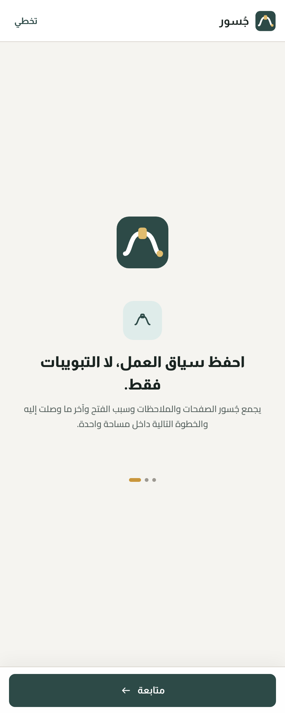</td>
<td width="33%">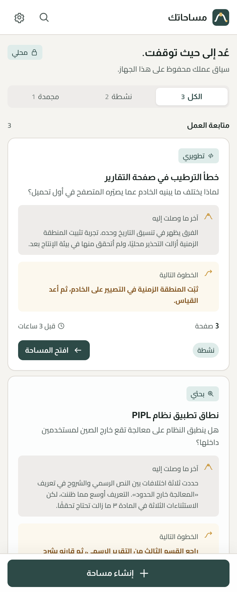</td>
<td width="33%"></td>
</tr>
<tr>
<td valign="top"><strong>أول تشغيل</strong><br>ما الذي يُحفظ وأين، قبل أن تبني عليه عملك.</td>
<td valign="top"><strong>مساحاتك</strong><br>الخطوة التالية أولًا، مرتبةً بالأحدث عملًا لا بالأحدث إنشاءً.</td>
<td valign="top"><strong>داخل المساحة</strong><br>نقطة التوقف والخطوة التالية فوق الصفحات.</td>
</tr>
<tr>
<td>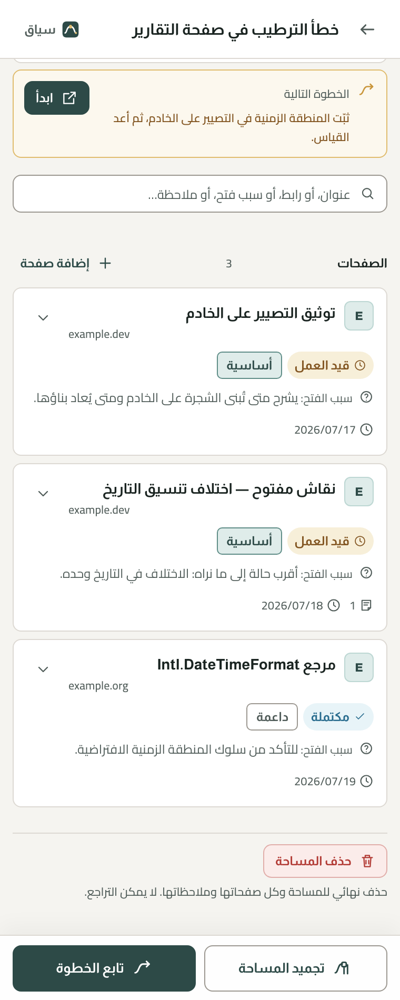</td>
<td>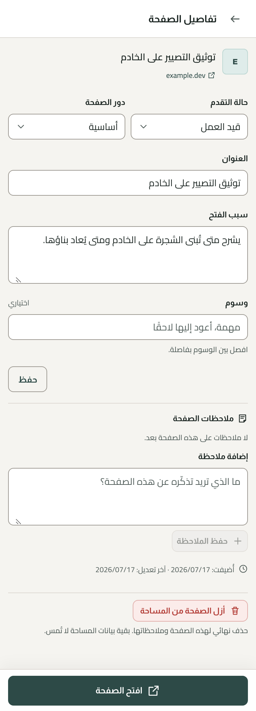</td>
<td>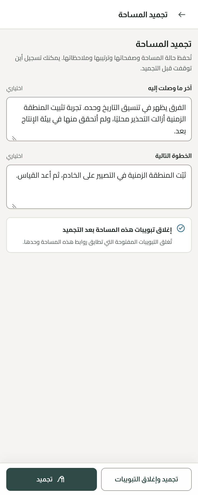</td>
</tr>
<tr>
<td valign="top"><strong>الصفحات والبحث والتصفية</strong><br>التقدم والدور وعدد الملاحظات لكل صفحة.</td>
<td valign="top"><strong>تفاصيل الصفحة</strong><br>سبب الفتح والتقدم والدور والوسوم والملاحظات.</td>
<td valign="top"><strong>التجميد</strong><br>تسجيل نقطة التوقف اختياري، وإغلاق التبويبات اختيار مستقل.</td>
</tr>
<tr>
<td></td>
<td></td>
<td>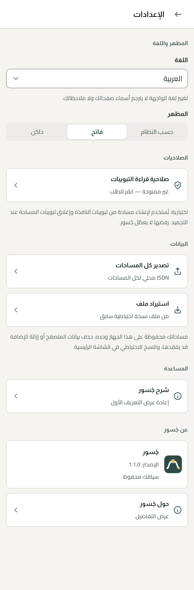</td>
</tr>
<tr>
<td valign="top"><strong>شاشة العودة</strong><br>أين توقفت والخطوة التالية وما بقي، قبل أن يُفتح تبويب واحد.</td>
<td valign="top"><strong>منشئ السياق</strong><br>مستوى التفصيل والقالب وما يُضمَّن، والمعاينة قبل النسخ.</td>
<td valign="top"><strong>الإعدادات</strong><br>اللغة والمظهر، وصلاحية التبويبات، والتصدير والاستيراد، وشاشة «حول».</td>
</tr>
</table>

<table>
<tr>
<td width="25%"></td>
<td width="25%">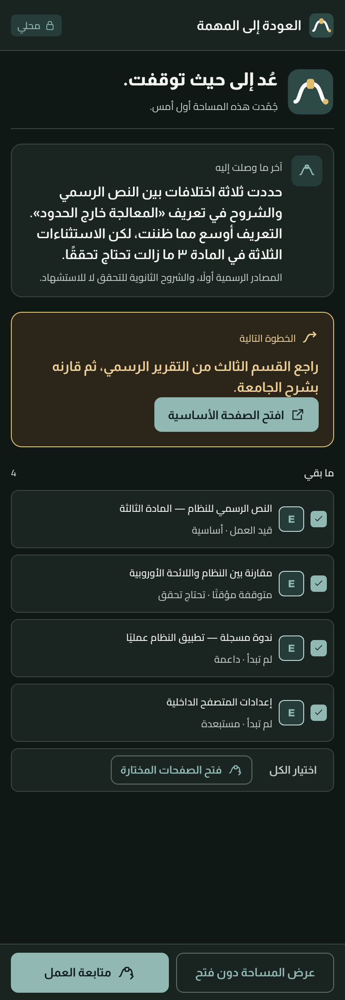</td>
<td width="25%">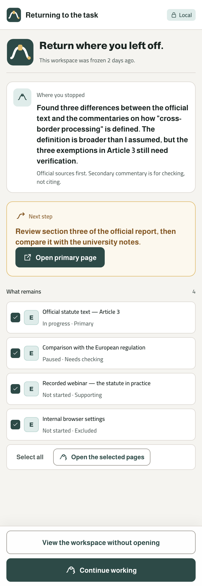</td>
<td width="25%">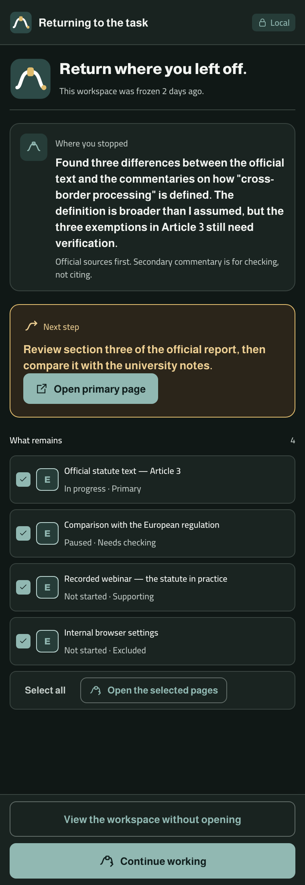</td>
</tr>
<tr>
<td align="center"><sub>عربي · فاتح</sub></td>
<td align="center"><sub>عربي · داكن</sub></td>
<td align="center"><sub>إنجليزي · فاتح</sub></td>
<td align="center"><sub>إنجليزي · داكن</sub></td>
</tr>
</table>

---

## التثبيت

**المتصفحات:** Google Chrome وMicrosoft Edge (Manifest V3 واللوحة الجانبية `chrome.sidePanel`)، وعليهما بُني جُسور وتُحقّق منه. ومتصفحات Chromium الأخرى التي تدعم اللوحة الجانبية (Brave وOpera وVivaldi) يُتوقع أن تعمل لكنها **لم تُختبر**. وFirefox غير مدعوم حاليًا ([قرار 0002](docs/decisions/0002-target-browsers.md)).

جُسور غير منشور في متجر Chrome ولا في Microsoft Edge Add-ons بعد؛ يُثبَّت من حزمة الإصدار على GitHub:

1. نزّل ملف `jusoor-…-chrome.zip` (أو `jusoor-…-edge.zip` لـEdge) من [صفحة أحدث إصدار](https://github.com/iSltanX/Jusoor/releases/latest).
2. فك ضغطه في مجلد دائم؛ الإضافة غير المضغوطة تعمل من هذا المجلد.
3. افتح `chrome://extensions` (أو `edge://extensions`)، وفعّل **وضع المطوّر**.
4. اضغط **تحميل غير مضغوط** (Load unpacked) واختر المجلد الذي يحوي `manifest.json`.
5. ثبّت أيقونة جُسور في شريط الأدوات واضغطها، فتُفتح اللوحة الجانبية.

> **ملاحظة:** الإضافة المحمّلة يدويًا لا تتحدّث تلقائيًا. للتحديث، صدّر نسخة JSON احتياطية، ثم استبدل محتوى المجلد نفسه بالإصدار الجديد واضغط «إعادة التحميل» في صفحة الإضافات؛ فالمتصفح يربط بيانات الإضافة غير المضغوطة بمسار مجلدها. وقد يعرض Chrome تنبيه وضع المطوّر عند التشغيل، ولا يمسّ ذلك بياناتك.

---

## للمطورين

المتطلبات: **Node.js 22.13** أو أحدث (يشترطه pnpm 11)، و**pnpm 11**.

```bash
git clone https://github.com/iSltanX/Jusoor.git
cd Jusoor
pnpm install
pnpm build            # → .output/chrome-mv3
pnpm build:edge       # → .output/edge-mv3
```

```bash
pnpm dev              # تشغيل التطوير (Chrome)
pnpm dev:edge         # تشغيل التطوير (Edge)
pnpm zip              # .output/jusoor-<الإصدار>-chrome.zip
pnpm zip:edge         # .output/jusoor-<الإصدار>-edge.zip
pnpm typecheck        # tsc --noEmit
pnpm lint             # eslint
pnpm test             # vitest
pnpm check            # typecheck ← lint ← test ← build
pnpm verify:identity  # فحص سلامة حزمة الهوية وحدها
```

> **ملاحظة على `pnpm dev`:** سياسة `connect-src 'none'` تمنع اتصال HMR، فيلزم إعادة تحميل الإضافة يدويًا بعد كل تعديل. وهذا مقصود.

### البنية

```
entrypoints → ui → app → core
                    ├→ storage
                    └→ browser
```

```
src/
├── core/         منطق المنتج — TypeScript خالص بلا آثار جانبية ولا نصوص واجهة
├── browser/      الموضع الوحيد لـ chrome.*
├── storage/      IndexedDB و chrome.storage.local
├── app/          تنسيق حالات الاستخدام
├── ui/           مكونات React والشاشات
├── i18n/         نصوص الواجهة (ar / en)
└── entrypoints/  background · sidepanel

tests/            اختبارات كل طبقة، و guards/ لحراس المعمارية والحدود
docs/decisions/   سجلات القرار المعماري (19)
identity/         حزمة الهوية المعتمدة — للقراءة فقط
licenses/fonts/   تراخيص الخطوط (OFL 1.1)
```

**الاتجاه مفروض بالاختبارات لا بالاتفاق.** حراس `tests/guards/` تُفشِل الاختبارات عند: ظهور `chrome.*` خارج `src/browser/`، أو مخالفة اتجاه الاعتماد بين الطبقات، أو أي واجهة شبكة أو مورد خارجي في المصدر أو المخرجات المبنية، أو أي تغيير في مجموعة الصلاحيات، أو أي مساس بحزمة الهوية، أو ألوان حرفية وخصائص اتجاهية مادية في CSS المكونات، أو شحن الخطوط بلا تراخيصها. وحراس المخرجات لا تعمل إلا حين يوجد مجلد `.output/`، فشغّل `pnpm test` بعد `pnpm build` ليشمل الفحص المخرجات أيضًا.

### قبل تعديل أي شيء

- [`Jusoor-Product-Constitution.md`](Jusoor-Product-Constitution.md) — ما هو المنتج، وما يرفض أن يصير إليه، ومعيار قبول أي إضافة.
- [`Jusoor-Identity-Constitution.md`](Jusoor-Identity-Constitution.md) — النظام البصري، والـTokens، والمكونات، والوصول، والثوابت.
- القرار المعني في [`docs/decisions/`](docs/decisions/).

`identity/` نسخة **مطابقة بايتًا ببايت** لمجموعة معتمدة من حزمة الهوية، يفرض ذلك حارس يقارنها ببصمات [`docs/identity-checksums.txt`](docs/identity-checksums.txt) (التفصيل في [`docs/identity-source.md`](docs/identity-source.md)). لا تُعدَّل، ولا يُضاف إليها ملف من إنتاجنا، والقيم المشتقة منها تعيش في `src/ui/theme/`.

### البلاغات

للإبلاغ عن خطأ أو اقتراح تحسين افتح بلاغًا في [Issues](https://github.com/iSltanX/Jusoor/issues)، وهي الوجهة نفسها لرابط «الإبلاغ عن مشكلة» في شاشة «حول».

---

## أسئلة متكررة

<details>
<summary><strong>هل جُسور متاح في متجر Chrome أو Edge؟</strong></summary><br>

ليس بعد. الإصدار 1.1.0 منشور في [إصدارات GitHub](https://github.com/iSltanX/Jusoor/releases/latest) مع حزمتَي Chrome وEdge، ولم يُرفع إلى أي من المتجرين. انظر [التثبيت](#التثبيت).
</details>

<details>
<summary><strong>أين بياناتي بالضبط؟</strong></summary><br>

على جهازك، داخل ملف تعريف متصفحك. المساحات والصفحات والملاحظات والتصنيفات في قاعدة **IndexedDB** محلية اسمها `jusoor`. واللغة والمظهر وعلامة أول تشغيل ومؤشر آخر مساحة في `chrome.storage.local`. ولا مكان آخر.
</details>

<details>
<summary><strong>ماذا يحدث إن حذفت بيانات المتصفح؟</strong></summary><br>

تفقد مساحاتك، فلا خادم يحمل نسخة منها، ويقول جُسور ذلك في أول تشغيل. صدّر نسخة JSON احتياطية من الإعدادات («تصدير كل المساحات»)؛ فهي نسخة كاملة قابلة لإعادة الاستيراد.
</details>

<details>
<summary><strong>هل يستطيع جُسور قراءة الصفحات التي أزورها؟</strong></summary><br>

لا، بالبنية لا بالوعد. لا يشحن content scripts ولا يطلب `scripting` ولا أي صلاحية موقع، فلا يمنحه المتصفح آليةً لقراءة المحتوى. ويقرأ **عنوان التبويب ورابطه** فقط، وبعد أن تطلب ذلك صراحةً.
</details>

<details>
<summary><strong>هل يستخدم ذكاءً اصطناعيًا؟</strong></summary><br>

لا. لا نموذج، ولا مفتاح API، ولا اتصال صادر. منشئ السياق يجمّع النص الذي **اخترته أنت** لتراجعه وتنسخه بنفسك.
</details>

<details>
<summary><strong>هل يستعيد موضع القراءة داخل الصفحة؟</strong></summary><br>

لا، ولا يدّعي ذلك. التقاط موضع القراءة يحتاج content script، وهو ما لا تشحنه هذه النسخة عمدًا. يفتح جُسور الصفحة ويبلّغ بصدق بما فعله.
</details>

<details>
<summary><strong>هل يعمل دون اتصال؟</strong></summary><br>

نعم، كاملًا. لا يحتاج الاتصال إلا فتحُ المصادر البعيدة نفسها.
</details>

---

## التراخيص

شيفرة جُسور مرخّصة بترخيص [MIT](LICENSE) — © 2026 سلطان.

الخطّان **Almarai** و**Cairo** موزَّعان تحت رخصة SIL Open Font License 1.1، ونصوصها في [`licenses/fonts/`](licenses/fonts/) وتُشحن داخل الحزمة المبنية. وتفاصيل كل اعتمادية في [THIRD_PARTY_NOTICES.md](THIRD_PARTY_NOTICES.md).

---

<p align="center">
  <sub>صُمّم وطُوّر بواسطة <strong>سلطان · Sultan</strong> — Design &amp; Development</sub><br>
  <sub>للتواصل: <a href="mailto:S@BySltan.com">S@BySltan.com</a></sub><br>
  <sub><a href="CHANGELOG.md">سجل التغييرات</a> · <a href="docs/privacy-policy.md">سياسة الخصوصية</a> · <a href="docs/decisions/">القرارات</a> · <a href="README.en.md">English</a></sub>
</p>
